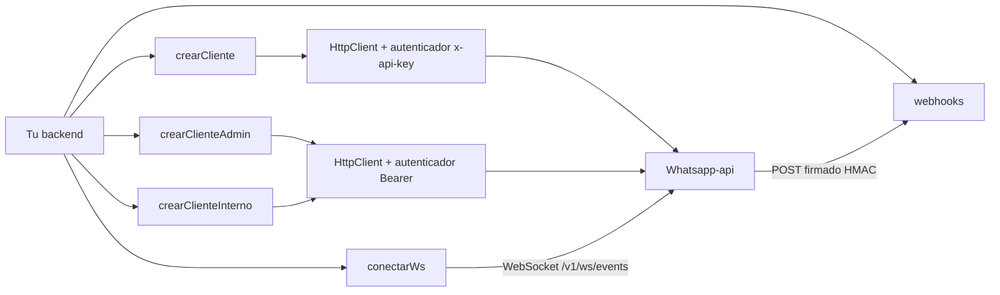

# Arquitectura — `@eva_solutions/whatsapp-sdk`

## 1. Vista global



Un paquete, cinco entry points (`src/index.ts`, `webhooks.ts`, `ws.ts`, `admin.ts`, `internal.ts`), cada uno ESM y CJS. Única dependencia de runtime: `zod`.

## 2. Estructura

```
src/
├── index.ts, webhooks.ts, ws.ts, admin.ts, internal.ts   # un entry por subpath
├── core/
│   ├── cliente/        # factories, validarBaseUrl, construirHttpClient, crearHttpClientConToken
│   ├── http-client/    # crearHttpClient, autenticadores (x-api-key, Bearer), reintentos, mapeo de errores, segmentoRuta
│   ├── validacion/     # validarEntrada (422 local), schemas comunes, enumTolerante
│   ├── paginacion/     # iterarPaginas, iterarCursor
│   ├── errors/         # ErrorConfiguracion
│   └── types/          # Resultado
└── features/<nombre>/
    ├── domain/         # schemas Zod y tipos
    ├── application/    # operaciones: (http) => (input, opciones?) => Resultado
    └── index.ts        # barrel: contrato público del feature
```

Features por subpath: `mensajes`, `chats`, `modo-bot` (envoltorio de `mensajes` con comportamiento humano; no tiene `infrastructure`), `sesion`, `programados`, `webhooks-fallidos`, `buffer-ws`, `billing`, `seguridad`, `webhook-secret` (`.`); `webhooks` y `notificaciones` (`./webhooks`); `ws` y `notificaciones` (`./ws`); `admin-*` (`./admin`); `internal-mensajes` e `internal-chats` (`./internal`; su modo bot reutiliza el núcleo de `modo-bot`).

`infrastructure/` existe solo donde hay un adaptador real: `webhooks` (HMAC y lectura limitada del body) y `ws` (construcción de la conexión). Los features que hablan HTTP no tienen adaptador: `application` recibe el `HttpClient` y lo llama directo (ver [ADR-003](./decisions.md#adr-003--sin-capa-adapter-por-feature)).

## 3. Un `HttpClient`, tres clientes

`construirHttpClient(opciones, autenticador)` es el punto único de validación (`baseUrl`, `timeout`, `reintentos`). Lo usan `crearCliente` (autenticador `x-api-key`), `crearClienteAdmin` y `crearClienteInterno` (autenticador Bearer: `autenticadorBearer`, con el proveedor de tokens que pasa el consumidor). Cada feature es una factory `(http) => facade`.

## 4. Flujo HTTP de una petición

1. **Validación local:** `validarEntrada(schema, input)`. Si falla, retorna `422` y no sale nada.
2. **Construcción de la URL:** `path` contra `baseUrl`; si el path cambia al normalizarse (`..`, `//host`, `?` incrustado), `400 Ruta inválida`. Los segmentos dinámicos pasan por `segmentoRuta`.
3. **Intento:** combina `AbortSignal.timeout`, `signal` del cliente y `signal` de la operación; el autenticador agrega headers **en cada intento** (el Bearer pide el token a `obtenerToken`); `fetch` con `redirect: "error"`.
4. **Respuesta:** 2xx se desenvuelve (`{ data }` → `data`, o el JSON completo si trae otras claves como `pagination`) y se valida con el schema; no-2xx se mapea a `ErrorResultado`.
5. **Reintento:** solo si la política lo permite (ver [configuration.md](./configuration.md#reintentos)). Aparte, si el autenticador declara `ante401` (el Bearer lo hace), un `401` lo invoca (invalida el token) y reintenta **una vez** en cualquier método, sin consumir el presupuesto de reintentos.

## 5. Webhooks y eventos

`notificaciones` define los schemas de evento compartidos por `./webhooks` y `./ws` (envelope `{ type, phone, data, timestamp }`). `clasificarEvento` devuelve un evento tipado o un `EventoDesconocido` (`conocido: false`): ver [ADR-005](./decisions.md#adr-005--enums-y-eventos-tolerantes-a-valores-nuevos-de-la-api).

Flujo de `verificarWebhookDesdeRequest`: header → cuerpo (con tope) → HMAC en tiempo constante → JSON → clasificación. Cada paso fallido retorna su código sin lanzar.

## 6. WebSocket

`conectarWs` es una máquina de estados sobre un `WebSocketLike`: abre `ws(s)://…/v1/ws/events`, responde el heartbeat, clasifica cada mensaje, y reconecta con backoff exponencial y jitter. No usa `HttpClient`.

## 7. Decisiones clave

Ver [decisions.md](./decisions.md).
